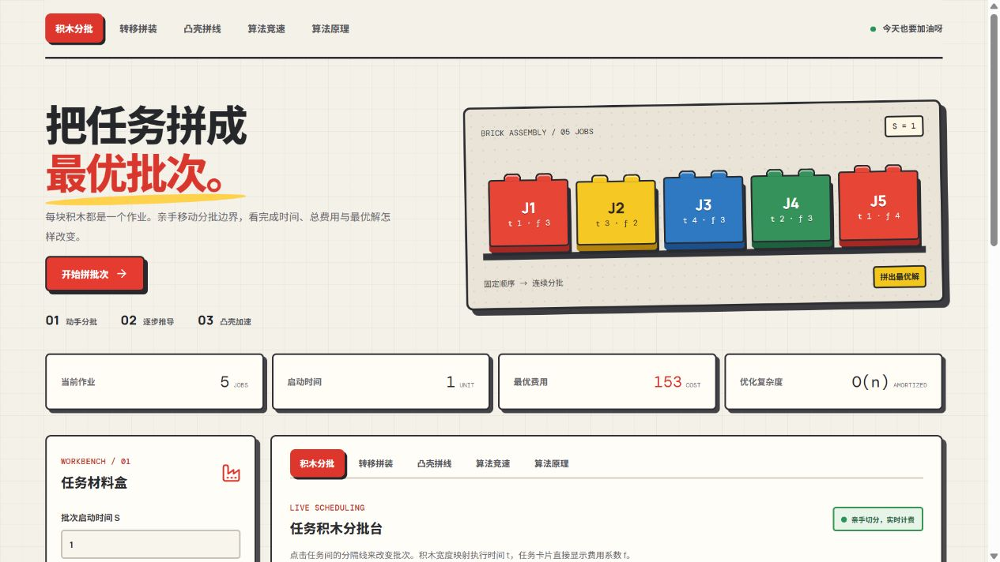

# LEGO BatchLab

用可交互的积木讲清楚最优批处理：先亲手划分连续批次，再观察 O(n²) 动态规划如何枚举决策，最后看单调凸壳将计算优化到摊还 O(n)。项目可在浏览器本地运行，无需后端。



## 快速开始

需要 Node.js 20+。运行跨语言测试还需要支持 C++17 的 `g++`。

```bash
npm ci
npm run dev
```

在终端显示的本地地址打开网站。生产构建和测试：

```bash
npm run build
npm test
```

## 可以做什么

- **积木分批**：编辑作业的执行时间 `t[i]`、费用系数 `f[i]` 与启动时间 `S`；点击相邻积木间的分隔线，实时查看完成时刻、各批费用和总费用。
- **转移拼装**：逐步回放每个 `dp[i]` 的候选 `j`，用积木区分已完成前缀、当前批次和尚未处理的作业；支持播放、暂停、前后单步、进度跳转与速度调节。
- **凸壳拼线**：查看本轮查询前的候选直线、函数值、队头移动、队尾剔除、查询点与维护后的队列。动画数据来自算法实际执行轨迹。
- **算法竞速**：以相同输入对比朴素 DP 与凸壳优化的比较次数、纯计算时间、最优费用及分批方案；动画播放时间不计入性能数据。
- **数据实验**：导入 `input.txt`、用种子生成可复现数据，或重置到答案为 **153** 的示例。超过 60 个作业时停止生成教学帧，并在 Web Worker 中计算结果。

## 问题与算法

按固定顺序排列的 `n` 个作业要划分为若干连续批次。一批耗时等于启动时间 `S` 加上批内执行时间之和，同批作业在批次结束时一起完成。目标是最小化 `Σ f[i]·C[i]`，其中 `C[i]` 是作业 `i` 的完成时刻。

令 `T[i]=Σ(k≤i)t[k]`、`F[i]=Σ(k≤i)f[k]`、`dp[0]=0`。枚举最后一批开始前的位置 `j`：

```text
dp[i] = min(0≤j<i) { dp[j] + (S+T[i]−T[j])·(F[n]−F[j]) }
```

若设 `x=S+T[i]`，历史状态 `j` 对应直线

```text
y_j(x) = −F[j]·x + dp[j] − T[j]·(F[n]−F[j])
dp[i] = x·F[n] + min(0≤j<i) y_j(x)
```

当 `t[i]`、`f[i]` 非负时，查询横坐标不减，直线斜率不增。实现用单调队列维护对后续查询有效的下凸壳，并用精确整数叉积比较，避免浮点交点误差。等斜率和费用并列时保留确定的一种最优方案；被队列删除的直线只对后续单调查询不再需要。

浏览器算法使用 `BigInt`；输入必须是非负 JavaScript 安全整数，作业数上限为 5000。C++ 程序使用 `__int128`，并限制 `0≤S,t[i],f[i]≤10^7`。

## C++17 文件输入输出

仓库中的 `input.txt` 是示例输入。程序从当前目录读取它，只把最小费用写入 `output.txt`；分批方案输出到标准错误流。

```bash
g++ -std=c++17 -O2 cpp/batchlab.cpp -o batchlab
./batchlab
cat output.txt
```

Windows PowerShell 可将可执行文件命名为 `batchlab.exe`，再运行 `./batchlab.exe`。示例输出为 `153`。输入格式：

```text
5
1
1 3
3 2
4 3
2 3
1 4
```

## 验证

`npm test` 覆盖示例、零值、等斜率、并列最优解、随机小样例的暴力/DP/凸壳一致性，以及 C++ 与 TypeScript 的 80 组跨语言一致性测试。`npm run build` 同时执行 TypeScript 类型检查和 Vite 生产构建。

## GitHub Pages

项目使用相对资源路径，并提供 `.github/workflows/pages.yml`。推送到 `main` 或 `master` 后，在仓库 **Settings → Pages → Build and deployment** 中选择 **GitHub Actions**。工作流会运行依赖安装、测试、构建和部署。部署地址通常是 `https://<用户名>.github.io/<仓库名>/`。

## 项目结构

```text
src/App.tsx          页面与交互
src/algorithms.ts     暴力、朴素 DP、凸壳优化与结构化轨迹
src/compute.worker.ts 大规模计算线程
src/*theme.css        积木视觉与响应式样式
src/*.test.ts         算法与轨迹测试
tests/cpp.test.ts     C++ / TypeScript 一致性测试
cpp/batchlab.cpp      C++17 独立程序
input.txt             示例输入
docs/preview.png      首页预览
.github/workflows/    GitHub Pages 自动部署
```

积木造型为原创视觉设计，不使用 LEGO 官方 logo，也不表示与 LEGO 集团存在关联。